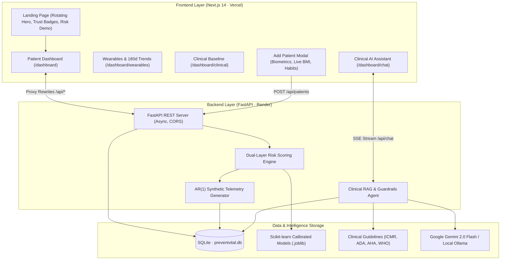

# PreventVital: Continuous Wearable Telemetry & Explainable Health Risk Screening

> **Final Year Engineering Project**  
> **Repository:** [https://github.com/PiyushBodhe23/Final_Year-Project](https://github.com/PiyushBodhe23/Final_Year-Project)  
> **Frontend:** Next.js 14 (React, TypeScript, Tailwind CSS, Framer Motion) — Deployed on **Vercel**  
> **Backend:** FastAPI, SQLAlchemy, SQLite, Scikit-learn, Google Gemini / Ollama RAG — Deployed on **Render**  

---

## 📋 Executive Summary

**PreventVital** is an end-to-end clinical AI and wearable telemetry health framework engineered to detect early metabolic (**Type 2 Diabetes**) and cardiovascular (**CVD**) risks years before physical symptoms manifest.

By synthesizing continuous passive telemetry (resting heart rate drift, heart rate variability, nocturnal SpO₂ hypoxia, sleep architecture, and daily steps) with clinical baselines (Indian Diabetes Risk Score and Framingham models), PreventVital provides an **explainable 0–100 risk range**, factor contributions, what-if counterfactual simulations, and a grounded **Clinical RAG AI Virtual Assistant**.

---

## 🏛️ System Architecture



---

## 🖥️ 1. Frontend & UI Deep-Dive (Presentation Guide)

The frontend is built using **Next.js 14 App Router**, **React 18**, **TypeScript**, **Tailwind CSS**, and **Framer Motion**. It supports seamless **Light/Dark modes** and is designed with an accessible, mobile-first responsive layout.

### A. Landing Page (`/`)
- **4 Auto-Switching Lifestyle Backgrounds**: Features a cinematic rotating carousel of 4 high-resolution wearable fitness backdrops with smooth 5.5s cross-fades and subtle Ken-Burns zoom effects.
- **Directional Dark Gradient**: A multi-stop gradient (`from-slate-950 via-slate-950/85 to-transparent`) ensures 100% text contrast and readability against photography.
- **Top Pill Badge & Gradient Typography**: Highlights *"Always Quietly Watching Out For You"* and *"You're Never Doing This Alone"* with a vibrant multi-stop text gradient.
- **Platform Metric Highlights**: 3-card metric strip showing `100 Cohort Profiles`, `180d Continuous Data`, and `Dual ML (Diabetes & CVD)`.
- **Interactive Persona Telemetry Card**: Visitors can immediately switch between 3 preview patients (*Priya - Optimal 84*, *Rahul - Moderate 54*, *Suresh - High Risk 28*) directly on the landing page to observe live Health Scores, RHR, SpO₂, and simulated alerts.
- **Floating Quick-Action Pill**: An anchored bottom-right button (`💬 Chat with AI Assistant`) linking directly to the AI counseling portal.

### B. Patient Dashboard (`/dashboard`)
- **Unified 100-Patient Directory**: An accessible, custom searchable dropdown containing 100 Indian patients with real-world names, age, sex, and calculated BMI.
- **Health Risk Index Ring**: A SVG circular gauge (0–100) color-coded by clinical severity (Green: Optimal >75, Amber: Borderline 45–74, Rose: High Risk <45).
- **Vitals Overview**: Real-time cards displaying Resting Heart Rate (bpm), Minimum Nocturnal SpO₂ (%), and Sleep Duration (hrs).
- **Dual Disease Risk Meters**: Side-by-side screening meters for **Diabetes** and **Cardiovascular Disease**, displaying exact composite scores, confidence intervals, and risk bands (*Low*, *Moderate*, *High*).
- **Explainable Factor Breakdown**: Transparent attribution cards showing exactly which signals moved the risk score (e.g. `+18.5 pts: Nocturnal SpO₂ dips <92%`, `+12.0 pts: Fasting glucose 112 mg/dL`).

### C. Add Patient Feature (`AddPatientDialog`)
Accessible via the **`+ Add Patient`** button in the dashboard header or inside the patient dropdown:
- **Demographics**: Full Name, Age (18–105), Biological Sex.
- **Anthropometry with Live BMI**: Height (cm), Weight (kg), and Waist Circumference (cm). Automatically computes real-time BMI and categorizes risk using Indian consensus guidelines (*Normal <23, Overweight 23–27.5, Obese >27.5*).
- **Lifestyle & Habits**: Physical Activity Level (*Sedentary*, *Moderate*, *Regular*), Smoking Status (with cigs/day for active smokers), Alcohol intake, Diet Quality, and a Perceived Stress slider (1–10).
- **Medical & Family History**: Family history of diabetes (weighted for IDRS), history of early cardiovascular disease, diagnosed hypertension, BP medication status, diagnosed diabetes, and prior stroke history.
- **Initial Lab Vitals (Collapsible)**: Pre-populated with standard reference defaults (Systolic BP, Diastolic BP, Fasting Glucose, HbA1c, Lipids).
- **Automated Pipeline**: Submitting the form calls `POST /api/patients`, which saves the patient, automatically synthesizes 180 days of wearable history, computes risk scores, and routes directly to the new patient's live dashboard.

### D. Wearables & Trends Portal (`/dashboard/wearables`)
- Visualizes 180 continuous days of wearable metrics.
- Multi-metric time-series graphs: Daily Steps vs. Active Minutes, Resting HR vs. Maximum HR, Nocturnal SpO₂ minima, and Sleep Stage Architecture (Deep, REM, Light %).
- 30-day rolling trend summaries with direction indicators (steady, climbing, dropping).

### E. Clinical Baseline Portal (`/dashboard/clinical`)
- Full clinical report card displaying measured biomarkers alongside reference physiological ranges (Fasting Blood Sugar, HbA1c, Lipids, Blood Pressure).

### F. Clinical AI Virtual Assistant (`/dashboard/chat`)
- RAG-powered interactive healthcare counselor.
- Grounded strictly in the active patient's 180-day telemetry and risk bands.
- Delivers structured responses: Direct answer, health context, **2–3 targeted precautions**, **3–4 concrete lifestyle suggestions**, and ends with **exactly 2 recommended follow-up questions**.

---

## ⚙️ 2. Backend & ML Engine Deep-Dive (Presentation Guide)

The backend is built with **FastAPI**, **SQLAlchemy ORM**, **SQLite**, **Pydantic v2**, and **Scikit-learn**.

### A. Dual-Layer Risk Engine
The risk engine implements a two-layer hierarchical architecture:

#### Layer 1: Clinical Baseline Risk
1. **Diabetes Baseline (50% IDRS + 50% Calibrated ML)**:
   - **Indian Diabetes Risk Score (IDRS)**: Validated clinical score by Dr. V. Mohan (MDRF, JAPI 2005) incorporating age bands, waist circumference (gender-specific thresholds), physical activity levels, and family history.
   - **Calibrated Logistic Model**: Calibrated probability trained on clinical biomarker data (fasting glucose, HbA1c, BMI).
2. **Cardiovascular Baseline (70% Calibrated 10-Yr Model + 30% Point Check)**:
   - **Framingham Heart Study Formulation**: Calibrated risk probability accounting for age, systolic blood pressure, blood pressure medication, smoking status, and lipid ratios.

#### Layer 2: Continuous Wearable Modulation
The clinical baseline is dynamically adjusted using 30-day wearable trends:
- **Resting Heart Rate (RHR) Drift**: Rising baseline resting heart rate over 30 days indicates cardiac strain or autonomic deconditioning.
- **Nocturnal Hypoxia (SpO₂ Dips)**: Repeated nighttime SpO₂ drops below 92% flag sleep apnea, which exacerbates insulin resistance and nocturnal hypertension.
- **Heart Rate Variability (HRV RMSSD)**: Low HRV indicates chronic sympathetic overdrive and reduced vagal tone.
- **Sleep Quality & Duration**: Insufficient sleep (<6 hrs) and low sleep efficiency modulate metabolic risk.
- **Activity & Step Volume**: High sedentary time adds risk points, while regular >10k daily steps deduct risk points.

### B. Uncertainty Quantification & Explainability
- **Monte Carlo Bootstrap Simulation**: Computes 95% Confidence Intervals (`ci_low`, `ci_high`) across 50 parameter perturbations, allowing clinicians to distinguish borderline cases from high-confidence risks.
- **Sign-Weighted Contribution Factors**: Breaks down the composite score into positive and negative point contributors for transparency.

### C. Synthetic Telemetry Generator (`ml/generate_synthetic.py`)
- Employs an **Autoregressive AR(1) Stochastic Process** to generate medically realistic 180-day continuous wearable streams.
- Conditioned on individual patient clinical burden: patients with high BMI, smoking, or hypertension realistically exhibit lower HRV, higher resting heart rate drift, and more frequent nocturnal SpO₂ dip anomalies.

### D. Clinical RAG & Guardrails Agent (`backend/app/services/chatbot/`)
- **Emergency Filter**: Scans incoming queries for critical emergency symptoms (e.g. *"crushing chest pain"*, *"difficulty breathing"*). Bypasses LLM and immediately triggers a high-priority advisory to dial **112 (National Emergency Services in India)**.
- **Knowledge Base (RAG)**: Retrieves evidence-based clinical guidelines from **ICMR**, **ADA**, **AHA**, and **WHO**.
- **Context Injection**: Automatically injects patient's current vitals, RHR 30-day slope, sleep averages, and risk bands into the system prompt.
- **Multi-LLM Fallback**: Primary integration with **Google Gemini 2.0 Flash** for high-speed cloud generation, with automatic failover to local **Ollama** (`llama3.1` / `llama3.2`) for offline privacy.

---

## 🗄️ 3. Database Schema

Managed via SQLAlchemy in `backend/app/models/tables.py`:
- **`patients`**: Demographics, lifestyle (smoking, alcohol, diet, stress), and family history.
- **`clinical_records`**: Measured snapshot labs (BP, glucose, HbA1c, total cholesterol, HDL, LDL, triglycerides).
- **`wearable_daily`**: Daily time-series rows (steps, active minutes, calories, RHR, avg HR, max HR, HRV, SpO₂ avg/min, sleep hours, sleep efficiency, skin temp, respiration rate).
- **`risk_reports`**: Stored composite risk scores, confidence intervals, disease types, and contributing factor JSON.

---

## 🚀 4. How to Run Locally

### Prerequisites
- Python 3.11+
- Node.js 18+ & npm

### Backend Setup
```bash
# 1. Activate virtual environment
.venv\Scripts\activate      # Windows
source .venv/bin/activate   # Linux/macOS

# 2. Install dependencies
pip install -r requirements.txt

# 3. Start FastAPI server
uvicorn backend.app.main:app --host 127.0.0.1 --port 8000 --reload --app-dir .
```
Backend API will be live at `http://127.0.0.1:8000` (Docs: `http://127.0.0.1:8000/docs`).

### Frontend Setup
```bash
# 1. Navigate to web directory
cd web

# 2. Install packages
npm install

# 3. Start Next.js development server
npm run dev
```
Open **[http://localhost:3000](http://localhost:3000)** in your browser.

---

## ☁️ 5. Deployment Guide

- **Frontend on Vercel**:
  - Connect your GitHub repository (`PiyushBodhe23/Final_Year-Project`).
  - Set **Root Directory** to `web`.
  - Add Environment Variable: `BACKEND_URL` = `https://your-backend.onrender.com`.
  - Deploy.
- **Backend on Render**:
  - Create a new **Web Service** connecting the repository.
  - Runtime: `Python 3` (uses `.python-version` 3.11.9).
  - Build Command: `pip install --upgrade pip setuptools wheel && pip install -r requirements.txt`.
  - Start Command: `uvicorn backend.app.main:app --host 0.0.0.0 --port $PORT --app-dir .`.
  - Deploy.

---

## 🎤 6. Presentation & Viva Defense Talking Points

| Question / Area | Key Defense Points to Speak |
| :--- | :--- |
| **Why not just use wearable data alone?** | Wearable data alone has high noise and lack of clinical specificity. A high heart rate could be a workout or fever. PreventVital couples wearable signals with established clinical frameworks (IDRS and Framingham) to make predictions medically meaningful. |
| **Why IDRS for Diabetes?** | Western diabetes risk calculators often underestimate diabetes in South Asians. The Indian Diabetes Risk Score (IDRS) is tailored for the Indian phenotype (abdominal obesity, lower BMI threshold). |
| **How does the AI Assistant stay safe?** | 1) Deterministic regex safety filter detects acute red flags and advises emergency care. 2) Strict RAG grounding prevents hallucinating medication prescriptions. 3) Context injection ensures advice matches the patient's individual risk index. |
| **How are wearable trends calculated?** | Using 30-day sliding window linear regression slopes (for RHR drift and HRV decline) and anomaly detection flags for nocturnal SpO₂ dips <92%. |
| **Is this meant to replace doctors?** | No. PreventVital is an explainable, preventive risk-screening tool designed to catch early health drift and serve as a conversation starter between patients and clinicians before irreversible damage occurs. |

---

## 📄 License
Academic Prototype · Developed for Final Year Engineering Project.
